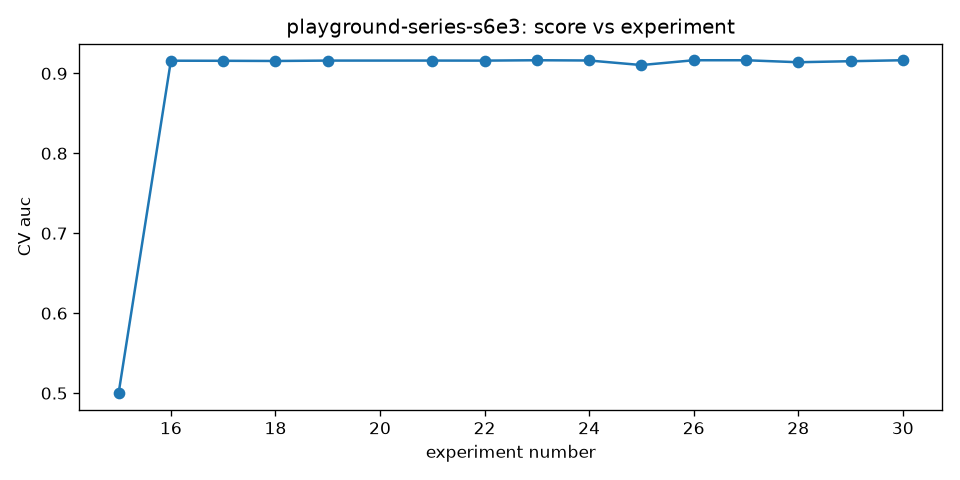

# medalist

[](https://github.com/hugomagee/medalist/actions/workflows/ci.yml)

A harness that lets an AI agent enter tabular data science competitions on its own, from first look at the data to final submission. The agent is the scientist. The harness is the lab that enforces the discipline the agent can't be trusted to keep itself.



## At a glance

**Input:** a competition bundle: training and test files, target column, ID column, scoring metric and a fixed cross validation policy (`competitions/<slug>/bundle.yaml`)

**Transformation:** the agent writes and runs one experiment at a time: EDA, features, model, error analysis, then the next idea. The harness controls everything around it:
* a holdout set is carved off **before** the agent sees any data, so the final grade can't leak
* cross validation folds are fixed per competition, so every experiment is compared fairly
* each experiment runs in a subprocess with a time limit and a total budget
* every config, score and artifact goes into an append only SQLite ledger
* the agent reads a digest of the ledger (`MEMORY.md`) before choosing its next experiment

**Output:** a validated `submission.csv`, a report (`reports/<slug>/RESULT.md`) and a chart of score against experiment number

**What I learned:** most of the value is in the guard rails, not the model. The harness has to still work when the agent is dumb, and not get in the way when it's smart.

## Results

| Competition | Task | Metric | Experiments | Score | Estimated rank |
| :--- | :--- | :--- | :---: | :---: | :--- |
| House Prices, Ames (live agent, real Kaggle submission) | regression | RMSLE | 17 | 0.11588 | 189 of 4,639 (top 4.1%), actual public leaderboard |
| Playground S6E10, airline satisfaction (live agent, real Kaggle submissions) | classification | AUC | 48 | 0.96093 (public) | ~1,290 of 3,554 (~top 36%), actual public leaderboard |
| Playground S6E3, Telco churn (live agent) | classification | AUC | 17 | 0.91709 | 655 of 4,143 (top 15.8%) |
| Playground S3E14 (live agent) | regression | MAE | 13 | 335.77 | 601 of 1,877 (top 32%) |
| Synthetic dry run (scripted agent, no LLM) | regression | MAE | 4 | 1.144 | plumbing check only |

**Why the ranks are estimates:** Kaggle doesn't publish the private test labels for Playground competitions. So each submission is scored on a seeded 20% holdout taken from the training data before the agent starts, and that score is placed on the real final leaderboard. On S6E3, bronze needed 0.91791, less than 0.001 away. Full caveats are in each `RESULT.md`, and [issue #1](https://github.com/hugomagee/medalist/issues/1) explains what data would allow exact grading.

**House Prices is different:** it is a Getting Started competition with a rolling leaderboard, so the agent trained on the real training set and its submission was scored by Kaggle itself. Its rank is the actual public leaderboard position, not an estimate. Leaving out the 74 entries that score about 0 by submitting the publicly leaked answers, it is 115 of 4,565 (top 2.5%). See [reports/house-prices/RESULT.md](reports/house-prices/RESULT.md).

## How to run

```bash
uv sync
uv run pytest          # 148 tests
uv run medalist --help
```

The agent's operating manual is [agent/AGENT.md](agent/AGENT.md). How to build a competition bundle is in [competitions/README.md](competitions/README.md). The full design is in [SPEC.md](SPEC.md) and the decisions I made along the way are in [DECISIONS.md](DECISIONS.md).

## How the code is organised

* `core/`: bundle loading, the sandboxed runner, CV policy, scoring, budget, ledger and submission checks
* `strategies/`: reusable building blocks the agent can import (baselines, feature engineering, blending and stacking)
* `agent/AGENT.md`: the rules the agent works under
* `competitions/`: one bundle per competition
* `reports/`: results, EDA and progression charts
* `tests/`: 148 tests, including property based tests for CV and scoring, and a dry run with a scripted agent

## Limitations

* Tabular and time series only. No deep learning, images, NLP or GPU competitions.
* Grading needs ground truth assembled by hand. Where the private labels can't be rebuilt, percentile grading isn't possible.
* The sandbox is a discipline boundary, not a security boundary. It stops honest mistakes in experiment code, not a determined attacker.
* The time budget counts experiment runtime only, not the agent's thinking time between experiments.
* Blending assumes all models share the same folds. The harness fixes folds per competition, so this holds unless the bundle's CV settings change mid run.

## Stack

Python 3.12, uv, pandas, scikit learn, LightGBM, XGBoost, CatBoost, Optuna, SQLite, Typer, Jinja2, pytest, Hypothesis, ruff, mypy, GitHub Actions. The agent is Claude Code.

## Author

Hugo Magee · MSc Business Analytics and Data Science, IE University · [LinkedIn](https://linkedin.com/in/hugo-magee-ooo)

MIT licence
