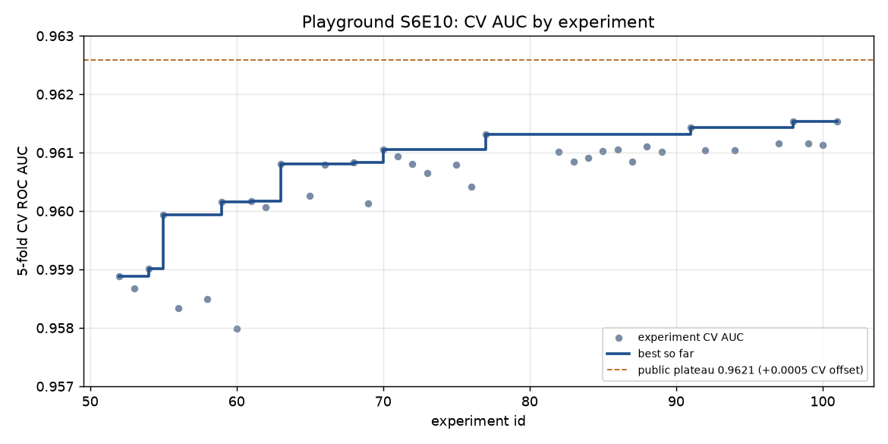

# RESULT — Playground S6E10, Predicting Airline Satisfaction (`playground-series-s6e10`)

Live competition, real Kaggle submissions. Metric: ROC AUC. Deadline 2026-10-31 23:59 UTC.

**Final submissions (to select on Kaggle):** e0101 (best CV) and e0091 (broader member set). See "Final selection".
**Best CV:** 0.961538 (e0101, 9-member LR stack). **Best public LB:** 0.96095 (e0101),
rank 1,269 of 3,591 (top 35.3%) on 2026-10-30 17:19 UTC. Top 1% needed 0.96223.



## Result in one paragraph

The agent finished well short of the brief's top-1% target. The public leaderboard is
extremely compressed: on 2026-10-30, top 25% was 0.96175 and top 0.5% was 0.96224, with
most of the top third sitting on a plateau around 0.9621. Our best honest pipeline (a
fold-safe stack of LightGBM, XGBoost, CatBoost and embedding-MLP members built on
original-data features) reached CV 0.96154 and public LB 0.96095, top 35.3%. Everything
that moved CV also moved the public LB by the same amount (offset -0.0005 throughout), so
the gap is not leaderboard noise. It is some approach worth about +0.0013 that the agent did
not find in 51 experiments (e0051-e0101). Public notebooks were deliberately not consulted.

## Data findings (in order of value)

| finding | evidence | gain |
|---|---|---|
| Original-data target means per value and per column pair are strong features | e0055 vs e0052 | +0.00105 CV |
| A "teacher" LightGBM trained only on the original data (AUC 0.955 on Kaggle train with no Kaggle labels) | e0059 vs e0055 | +0.00022 |
| Labels depend on **individual Flight Distance values**: every Kaggle distance value exists in the original; residuals grouped by distance value had z = 33.6 overdispersion. Fold-safe per-value Kaggle-label TE | e0063 vs e0059 | +0.00065 CV, +0.00056 LB |
| The distance effect is keyed on **digit chunks** (last 3 digits pool to z = 53, more than exact values), consistent with a token-based generator. Already captured by the per-value TE | e0068 vs e0063 | +0.00003 (tie) |
| Slower, higher-capacity LightGBM (lr 0.02, 127 leaves) | e0070 vs e0068 | +0.00022 |
| Appending the original rows to training (features built without their own labels) | e0076 paired, e0085, e0084 | +0.0002 (raw TE set), +0.0001 XGB/NN, 0 LightGBM |
| NN seed bagging (single seeds are noisy) | e0073, e0083 bag curves | +0.0008 for 3 seeds |
| Embedding MLP on the full feature set, wide (1024-512-256, dropout 0.4), seed-bagged | e0097 | best single model, 0.96116 |
| CatBoost with all 21 columns categorical (CTR combinations <= 3) | e0092 | 0.96104 alone; stack weight ~0.2 |
| Stacking diverse members (LR on logits) | e0077, e0091, e0101 | +0.0004 over best single |

## What failed (with numbers)

- Generic row-wise FE (rating sum/std/min/max, delay transforms): -0.00021 (e0053).
- Ratings/Age as native LightGBM categoricals: -0.00054 (e0056).
- Kaggle-label TE of high-order rating keys (e0058, -0.00039) and of all column pairs/triples
  (e0093, -0.0001..-0.0002): the nested TE is noisier on fold-train than on valid rows and the
  GBM over-trusts it. Only the per-value distance keys benefit from Kaggle-label TE.
- Widening distance crosses (e0066), density/typicality features (e0072), 6-teacher bank
  (+0.0001 only, e0065), NN teacher and covariate-shift-weighted teacher (offline, worse),
  same-distance kNN on the original (no residual correlation), post-hoc residual random-effect
  corrections on the stack (all negative), LightGBM stacker with segment context (below LR).
- Higher capacity than e0070 (lr 0.01, 255 leaves): worse on fold 0 and too slow (e0074).
- Exact/near duplicates: no train/test/original exact matches; no id-order signal.

## Noise floor

- Seed-to-seed CV std of the raw LightGBM: 0.00002 (5-fold mean); per-fold paired
  differences up to 0.00015. Differences below ~0.0001 were treated as ties.
- Hanley-McNeil SE of AUC on the ~60k public rows: 0.00085; on ~240k private rows: 0.00042.

## CV vs public LB

See `cv_vs_lb.csv` (generated by `scripts/s6e10_report.py`).

| submission | CV AUC | public LB | CV - LB |
|---|---|---|---|
| e0052 raw LightGBM | 0.958881 | 0.95843 | 0.00045 |
| e0059 + original TE + teacher | 0.960153 | 0.95964 | 0.00051 |
| e0063 + per-value distance TE | 0.960805 | 0.96020 | 0.00061 |
| e0077 6-member stack | 0.961315 | 0.96077 | 0.00055 |
| e0091 14-member stack | 0.961425 | 0.96089 | 0.00054 |
| e0098 7-member stack | 0.961528 | 0.96093 | 0.00060 |
| e0101 9-member final stack | 0.961538 | 0.96095 | 0.00059 |

## Process problems (honest accounting)

- 18 of the 51 ledger slots failed or were killed: 4 killed for projected runtime (CatBoost with
  default CTR complexity, extra-slow LightGBM), 1 OpenMP deadlock (LightGBM + torch libomp),
  2 killed during a swap-thrash episode (two float64 feature builds plus offline jobs on a
  16 GB machine), 2 lost to the Mac sleeping overnight with the lid closed (~9 h of wall
  time; Python's timeout clock does not advance during sleep), 1 queue race (a stack launched
  before its member finished), 1 refuted-and-killed experiment (e0093), and 3 more killed
  for projected runtime on 30 Oct (e0095 CatBoost with original rows at 39 min/fold, e0096
  two-seed fb_v4 LightGBM next to an NN). On 30 Oct the Mac also ran on battery twice
  (down to 7%) with the lid closed once more; e0097 survived a sleep mid-run.
- Fixes are logged in DECISIONS.md: float32 features, memory-guarded dispatcher,
  OMP_WAIT_POLICY=PASSIVE, keep-awake, stacks launched by hand.

## Final selection

Kaggle scores the private leaderboard on the 2 submissions selected by the team.

1. **e0101**: the best CV (0.961538) and best public LB (0.96095). It is a 9-member
   fold-safe LR stack of the fb_v4 NN (two seed bags), fb_v4 LightGBM (two seeds),
   all-categorical CatBoost, NN and XGBoost trained with the original rows appended, and
   the all-pairs original-TE LightGBM.
2. **e0091**: the most robust/diverse alternative (CV 0.961425, LB 0.96089). It stacks 14
   members built mostly on the earlier fb_v3 feature set (two LightGBM configs, XGBoost,
   CatBoost, five NNs), so it hedges against anything specific to the fb_v4 features
   (the 6-teacher bank and the ~260 extra original-label TEs) that dominate e0101.

The two picks differ by 0.00011 CV, within ~0.3 private-LB standard errors. Neither is
expected to change rank by more than a few hundred places on the private leaderboard.

## Reproduce

```
uv run python scripts/prepare_playground_s6e10.py      # needs raw/ (Kaggle zip + original)
uv run medalist run playground-series-s6e10 --exp <id>
uv run medalist submit playground-series-s6e10 --exp <id>
uv run python scripts/s6e10_report.py
```

Shared logic: `strategies/s6e10.py` (feature builders `FeatureBuilder`, `fb_v3_32`, `fb_v4`,
`original_rows_v3`; GBM/NN fold helpers; `stack_logistic`).
